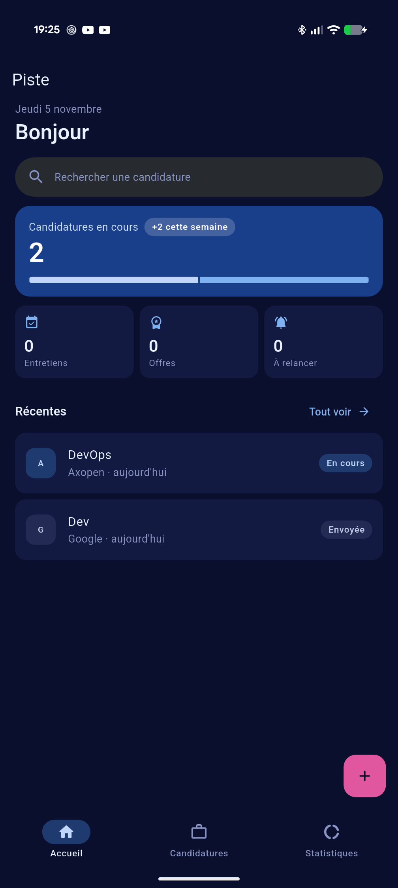
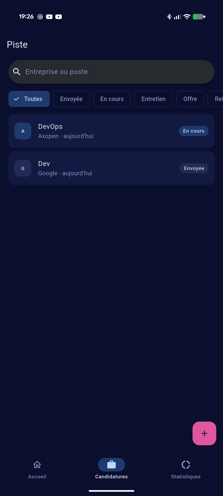
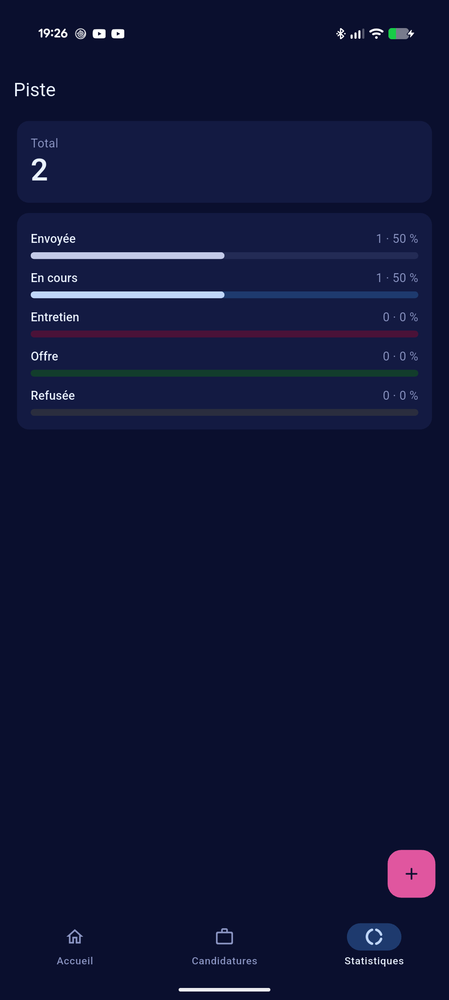

# Piste

Carnet de suivi de candidatures pour Android, qui fonctionne **hors ligne**.

Quand on postule à plusieurs entreprises en parallèle, les informations se
dispersent entre courriels, sites et notes. Piste les rassemble : chaque
candidature a un statut, des dates et des notes, et l'accueil indique en un
coup d'œil ce qui avance et qui relancer. Il n'y a ni compte ni serveur : les
données restent sur le téléphone.

Public visé : une personne en recherche d'emploi ou d'alternance qui suit
quelques dizaines de candidatures.

> Projet réalisé dans le cadre d'une formation Flutter (2026). Le périmètre
> détaillé est dans [SPECIFICATION.md](SPECIFICATION.md).

## Essayer l'application

1. Sur le téléphone Android (Android 7.0 ou plus récent), télécharger
   `piste-1.0.0-android.apk` depuis la release **v1.0.0** du dépôt.
2. L'ouvrir. Android demande d'autoriser l'installation depuis l'application
   qui a ouvert le fichier (navigateur ou gestionnaire de fichiers) :
   l'autoriser pour cette application seulement.
3. Au premier lancement, la liste est vide : toucher « Ajouter une
   candidature ».

Scénario de démonstration : ajouter deux candidatures, filtrer sur un statut,
en modifier une, fermer complètement l'application puis la relancer. Les
données sont toujours là.

## Captures

Prises dans l'application réelle, sur un Pixel 9 Pro XL.

| Accueil | Candidatures | Statistiques |
|---|---|---|
|  |  |  |

## Les trois écrans

| Écran | Ce qu'il montre |
|---|---|
| **Accueil** | La date, une carte de synthèse (candidatures en cours, nouvelles de la semaine, répartition par statut), trois compteurs (Entretiens, Offres, À relancer) et les trois candidatures modifiées le plus récemment. |
| **Candidatures** | La liste complète, de la plus récente à la plus ancienne, avec une recherche et des filtres par statut. |
| **Statistiques** | Le total, puis pour chaque statut le nombre, la proportion et une barre. |

## Fonctionnalités

- Créer, consulter, modifier et supprimer une candidature : entreprise,
  poste, statut, date de candidature, prochaine relance, lien vers l'offre et
  notes.
- Cinq statuts : Envoyée, En cours, Entretien, Offre, Refusée.
- Une candidature est **à relancer** quand sa date de relance est arrivée et
  qu'elle n'est ni acceptée ni refusée.
- Recherche sur l'entreprise et le poste, sans tenir compte des majuscules,
  combinée à un filtre par statut. « Aucun résultat » propose d'effacer la
  recherche.
- Suppression après confirmation, dans une boîte de dialogue qui nomme la
  candidature.
- Formulaire validé : champs obligatoires, lien complet en `http://` ou
  `https://`, bouton désactivé pendant l'enregistrement (un double appui ne
  crée qu'une candidature).
- États distincts : chargement, liste vide avec invitation, erreur de lecture
  avec « Réessayer ».
- Thème clair et sombre, qui suit le réglage d'Android. Interface en
  français, calendrier compris.

## Stack

| | |
|---|---|
| Framework | Flutter (stable), Dart avec null safety, Material 3 |
| Cible | Android |
| Stockage | SQLite (`sqflite`, `path`) |
| Gestion d'état | `ChangeNotifier` + `ListenableBuilder` (inclus dans Flutter) |

## Architecture

```
lib/
  main.dart     crée le repository et le contrôleur, et les libère
  models/       objets métier et calculs purs (filtre, synthèse)
  data/         contrat de repository, implémentation SQLite, StorageException
  state/        contrôleur ChangeNotifier
  ui/           écrans, widgets et thème
```

Les données circulent dans un seul sens :

```
écran  →  ApplicationsController  →  JobApplicationRepository  →  SQLite
(ui/)        (state/)                   (data/, contrat)
```

- Aucun écran ne contient de requête SQL ni de calcul : les filtres et les
  statistiques sont des classes pures de `models/`, testées sans interface.
- Le contrôleur ne connaît que le **contrat** du repository. Les tests lui
  donnent un faux repository en mémoire, capable de simuler une panne ou une
  lenteur.
- Le stockage ne lève qu'une seule exception, `StorageException`. Les écrans
  n'attrapent qu'elle, et une erreur de programmation fait donc échouer les
  tests au lieu d'être masquée.

## Trois choix justifiés

**1. SQLite pour les candidatures.** Ce sont des enregistrements structurés,
qu'on trie, compte et modifie un par un. SQLite donne un schéma versionné
(`onCreate`, `onUpgrade`) pour faire évoluer la table sans perdre les données,
et des requêtes paramétrées (`whereArgs`). `shared_preferences` est fait pour
quelques réglages, pas pour une liste qui grandit.

**2. `ChangeNotifier` pour l'état.** L'application partage une seule liste
entre trois onglets et deux écrans. `ChangeNotifier` et `ListenableBuilder`
suffisent, sont inclus dans Flutter et se lisent sans connaître de
bibliothèque. L'état affiché (chargement, vide, erreur, données) est calculé à
partir des données, jamais stocké à part : il ne peut pas les contredire.

**3. Le moins de dépendances possible.**

| Paquet | Pourquoi |
|---|---|
| `sqflite` | accès à SQLite sur Android |
| `path` | construire le chemin du fichier `piste.db` |
| `flutter_localizations` (SDK) | calendrier et textes de Material en français |

`cupertino_icons`, ajouté par défaut à la création du projet, a été retiré :
l'application n'utilise que les icônes Material.

**Compromis assumé.** Le contrôleur garde toute la liste en mémoire et filtre
en Dart plutôt qu'en SQL. C'est plus simple et instantané pour quelques
centaines de candidatures. Pour des dizaines de milliers, il faudrait filtrer
et paginer dans la base.

## Lancer le projet

```bash
flutter pub get
flutter run
```

### Construire l'APK signé

La version release est signée avec une clé personnelle. Ni la clé ni ses mots
de passe ne sont dans le dépôt : `android/key.properties` et `*.jks` sont
ignorés par Git. Sans ce fichier, le build release s'arrête au lieu d'utiliser
la clé de débogage.

```bash
# Une seule fois : créer la clé, hors du dépôt
keytool -genkey -v -keystore ~/upload-keystore.jks -keyalg RSA \
  -keysize 2048 -validity 10000 -alias upload
```

Puis créer `android/key.properties` :

```properties
storePassword=…
keyPassword=…
keyAlias=upload
storeFile=/home/<utilisateur>/upload-keystore.jks
```

```bash
flutter build apk --release
```

L'APK est produit dans `build/app/outputs/flutter-apk/app-release.apk`.

## Tests

```bash
flutter analyze
flutter test
```

- **100 tests automatisés**, unitaires et de widgets, sans SQLite. Ceux qui
  vérifient une exigence de la spécification portent son numéro dans leur nom
  (`T3 — …`, `F7 — …`, `S1 — …`).
- Ils couvrent aussi les situations du quotidien :
  - un petit écran avec la police agrandie ;
  - des noms d'entreprise très longs ;
  - le bouton retour Android ;
  - un double appui sur « Enregistrer » ;
  - une panne de lecture ou d'écriture ;
  - le contraste des couleurs dans les deux thèmes.
- **Recette manuelle** sur téléphone : [RECETTE.md](RECETTE.md). Elle couvre
  ce que les tests ne peuvent pas vérifier, comme la persistance après
  redémarrage, le clavier ou TalkBack. Le tableau en fin de fichier indique où
  chaque exigence est vérifiée.

### Une difficulté rencontrée

Le test « petit écran et police doublée » a fait apparaître deux débordements
invisibles sur un téléphone réglé normalement :

- une étiquette de l'accueil, corrigée en remplaçant `Row` par `Wrap`, qui
  passe à la ligne ;
- la liste déroulante du statut, corrigée avec `isExpanded`.

La règle retenue : ne jamais réduire la police pour « faire tenir », mais
laisser le contenu passer à la ligne ou défiler.

## Limites et améliorations

- Pas de compte ni de synchronisation entre appareils : changer de téléphone
  fait perdre les données. Un export ou une sauvegarde serait la première
  amélioration.
- Pas de notification de relance. Une notification locale le jour de la
  relance compléterait le compteur « À relancer ».
- La recherche tient compte des accents : « developpeur » ne trouve pas
  « Développeur ».
- Les pourcentages arrondis peuvent ne pas faire exactement 100.
- Android uniquement : ni web ni iOS.
